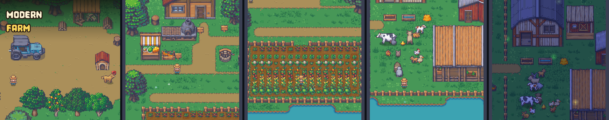

<table width="100%">
<tr>
<td width="50%" valign="top">

### 👋 Halo, saya Misbah

[)](https://github.com/misbah2121)

- 💻 Developer **mobile, web, dan game**
- 📍 Pangkalpinang, Bangka Belitung
- 🎮 Sedang membangun game **Modern Farm** di Godot 4

</td>
<td width="50%" valign="top">

### 🧰 Tech Stack

  

  

</td>
</tr>
</table>

### 🌾 Proyek Utama: [Modern Farm](https://github.com/misbah2121/ModernFarm)

<table width="100%">
<tr>
<td width="25%" align="center">🌱 <b>16 tanaman</b> + panen langka</td>
<td width="25%" align="center">🐄 <b>9 jenis ternak</b> bisa beranak</td>
<td width="25%" align="center">🎣⛏️🍳 <b>Mancing, tambang</b> & memasak</td>
<td width="25%" align="center">🏘️🚜 <b>Desa & NPC</b> quest, kios, traktor</td>
</tr>
</table>

  Game <b>farming & life-sim pixel art 2D</b> buatan sendiri dengan <b>Godot 4</b>, dikembangkan dalam 23 phase.  
  
  
  

### 🚀 Proyek Lainnya

<table width="100%">
<tr>
<td width="50%" valign="top">

**[📱 Life Manager](https://github.com/misbah2121/UAS-DFM-LIFEMANAGER)** 
Aplikasi pengelola tugas, keuangan, kesehatan, dan belanja. 
 

</td>
<td width="50%" valign="top">

**[🌾 Modern Farm](https://github.com/misbah2121/ModernFarm)** 
Game farming pixel art 2D dengan 23 phase pengembangan. 
 

</td>
</tr>
</table>

### 📊 Statistik GitHub

<table width="100%">
<tr>
<td width="50%" valign="top"></td>
<td width="50%" valign="top"></td>
</tr>
</table>

